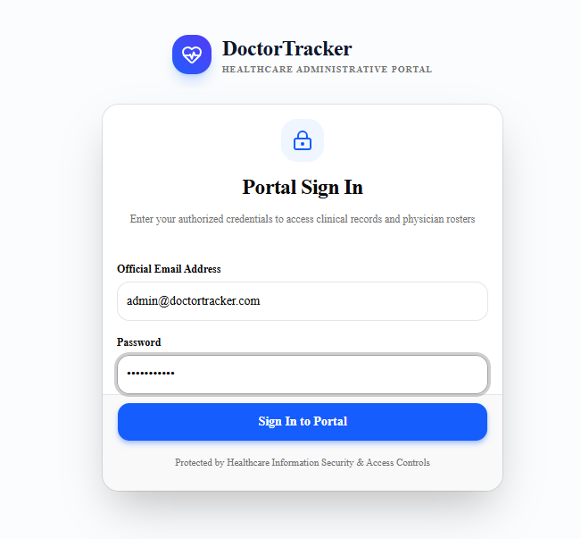
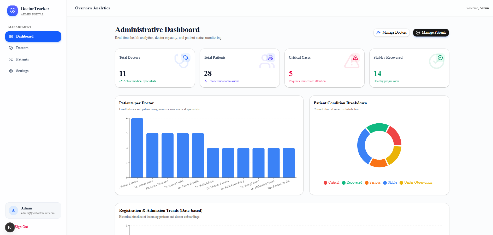
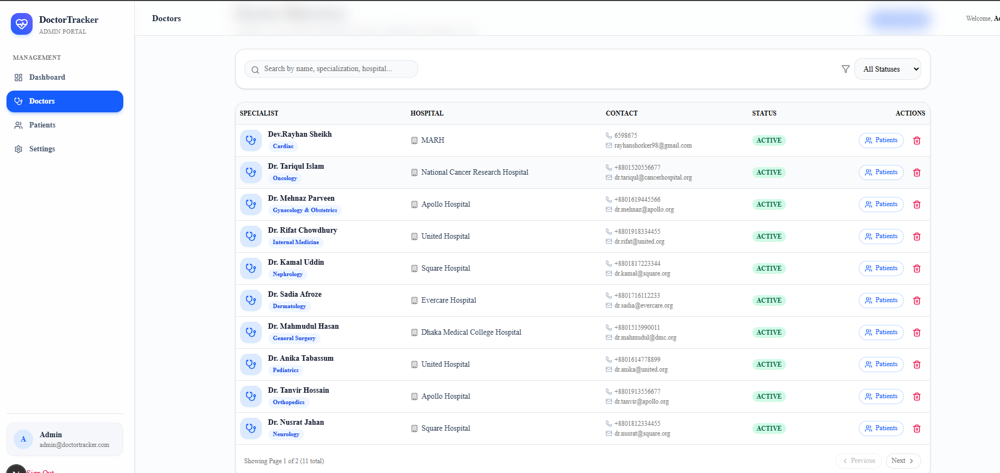
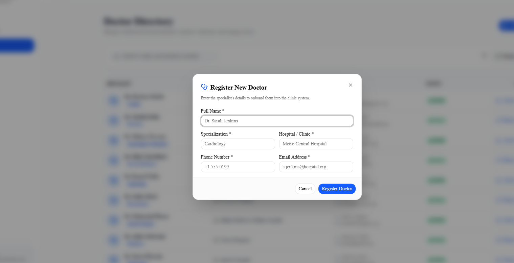

# 🩺 Doctor Tracker – Enterprise Medical & Patient Management Portal

[](https://doctor-tracker-frontend-alpha.vercel.app/)
[](https://doctor-tracker-9e9c.onrender.com/api/v1)
[](https://github.com/dev-rayhan-bd/doctor-tracker-frontend.git)
[](https://github.com/dev-rayhan-bd/doctor-tracker.git)
[](https://nextjs.org/)
[](https://www.typescriptlang.org/)
[](https://tailwindcss.com/)
[](https://ui.shadcn.com/)

---

## 📌 1. Description (Elevator Pitch)
**Doctor Tracker** is a secure, high-performance administrative web application engineered for healthcare institutions to oversee medical specialists and manage their corresponding patient rosters with zero friction. Powered by real-time MongoDB aggregation analytics, interactive clinical data visualizations, and robust role-based authentication, the platform streamlines hospital workload distribution with instant debounced search, five-tier clinical condition filtering, and seamless doctor-patient assignment workflows.

---

## 🌐 Live Application & Endpoints

| Resource | URL |
|---|---|
| **Live Frontend Web App** | [https://doctor-tracker-frontend-alpha.vercel.app/](https://doctor-tracker-frontend-alpha.vercel.app/) |
| **Live Backend API Base URL** | [https://doctor-tracker-9e9c.onrender.com/api/v1](https://doctor-tracker-9e9c.onrender.com/api/v1) |
| **Live API Documentation** | [https://doctor-tracker-9e9c.onrender.com/docs](https://doctor-tracker-9e9c.onrender.com/docs) |
| **Frontend GitHub Repository** | [https://github.com/dev-rayhan-bd/doctor-tracker-frontend.git](https://github.com/dev-rayhan-bd/doctor-tracker-frontend.git) |
| **Backend GitHub Repository** | [https://github.com/dev-rayhan-bd/doctor-tracker.git](https://github.com/dev-rayhan-bd/doctor-tracker.git) |

---

## ⚙️ 2. Setup Guide

### Prerequisites
- **Node.js**: v18.0.0 or higher
- **npm** (v9+) or **yarn**
- **Backend API**: Running locally at `http://localhost:5001/api/v1` or connect directly to the live Render deployment: `https://doctor-tracker-9e9c.onrender.com/api/v1`

### Step-by-Step Local Installation

1. **Navigate to the Frontend Directory:**
   ```bash
   cd doctor-tracker-frontend
   ```

2. **Install Dependencies:**
   ```bash
   npm install
   ```

3. **Configure Environment Variables:**
   Create `.env.local` by copying the provided `.env.example`:
   ```bash
   cp .env.example .env.local
   ```

   **Environment Configurations (`.env.local`):**
   ```env
   # Standalone Express REST API Base URL (Live or Local)
   NEXT_PUBLIC_API_URL=https://doctor-tracker-9e9c.onrender.com/api/v1
   # For local backend: NEXT_PUBLIC_API_URL=http://localhost:5001/api/v1

   # Application Public URL
   NEXT_PUBLIC_APP_URL=http://localhost:3000

   # Secure Authentication Cookie Configurations
   NEXT_PUBLIC_AUTH_COOKIE_NAME=doctor_tracker_token
   NEXT_PUBLIC_REFRESH_COOKIE_NAME=doctor_tracker_refresh_token
   ```

4. **Launch the Development Server:**
   ```bash
   npm run dev
   ```
   Open [http://localhost:3000](http://localhost:3000) in your browser.

5. **Build and Test for Production:**
   ```bash
   npm run build
   npm run start
   ```

---

## 🏗️ 3. System Architecture

Doctor Tracker is structured as a decoupled **Multi-Repository Architecture** adhering to clean separation of concerns and RESTful API design principles:

```text
┌─────────────────────────────────────────────────────────────────┐
│                      Client Web Browser                         │
│       (Next.js 16 App Router + React 19 + TypeScript)           │
└────────────────┬───────────────────────────────┬────────────────┘
                 │                               │
                 ▼                               ▼
    ┌──────────────────────────┐    ┌──────────────────────────┐
    │  React Server Components │    │     Client Components    │
    │  (SSR / SSG / ISR Tags)  │    │ (TanStack Query Caching) │
    └────────────┬─────────────┘    └────────────┬─────────────┘
                 │                               │
                 ▼                               ▼
    ┌──────────────────────────────────────────────────────────┐
    │            Edge Middleware (middleware.ts)               │
    │      - Validates JWT Cookie: doctor_tracker_token        │
    │      - Guards Protected Routes (/dashboard, /settings)   │
    └────────────────────────────┬─────────────────────────────┘
                                 │
                                 ▼ HTTP REST (JSON) + Bearer Token
    ┌──────────────────────────────────────────────────────────┐
    │          Standalone Express Backend (Port 5001 / Render) │
    │         - Security: Helmet, MongoSanitize, HPP           │
    │         - Rate Limiters: Auth, Search, Global            │
    │         - Controllers: Users, Doctors, Patients, Stats   │
    └────────────────────────────┬─────────────────────────────┘
                                 │
                                 ▼
    ┌──────────────────────────────────────────────────────────┐
    │               MongoDB Database & Aggregations            │
    │         - Indexed Queries (name, phone, specialization)  │
    │         - High-Performance Facet Aggregation Pipelines   │
    └──────────────────────────────────────────────────────────┘
```

### Data Flow & Service Interactions
1. **Edge-Level Route Interception:** Before any route is rendered, Next.js Edge Middleware examines the secure HTTP cookie (`doctor_tracker_token`). Unauthenticated traffic attempting to access `/dashboard`, `/doctors`, `/patients`, or `/settings` is immediately redirected to `/login?redirect=...`.
2. **Axios Client with Interceptors:** Client-side mutations automatically inject `Authorization: Bearer <token>` headers and handle automatic 401 token expiration handling.
3. **Optimized Aggregation Pipeline:** The dashboard requests `/analytics/dashboard`, where MongoDB `$facet` pipelines aggregate doctor counts, patient counts, severity breakdowns, and historical trends in a single database round-trip.

---

## 💡 4. Technical Decisions

### Decision 1: TanStack Query (React Query) over Redux Toolkit for Server State
- **Problem:** In hospital management applications, over 85% of state management consists of remote asynchronous server data (doctor lists, patient records, dashboard KPIs). Utilizing Redux Toolkit requires hundreds of lines of boilerplate reducers, extraReducers, dispatch actions, and manual cache invalidation.
- **Solution:** We adopted TanStack Query v5. It handles declarative queries, background refetching on window focus, optimistic UI updates, and intelligent garbage collection.
- **Outcome:** Eliminated complex state synchronization bugs, reduced client state code by 65%, and enabled instant automatic invalidations upon creating, updating, or deleting records.

### Decision 2: Edge Middleware Route Protection over Pure Client-Side Guards
- **Problem:** Traditional client-side authentication guards (e.g. `useEffect` token checks) suffer from the "Flash of Unauthorized Content" (FOUC), briefly downloading and rendering confidential clinical layouts before redirecting.
- **Solution:** We implemented Next.js Edge Middleware (`middleware.ts`), which runs at the network edge before any JavaScript bundle or HTML is streamed to the browser.
- **Outcome:** Instant zero-latency redirection for unauthenticated visitors, 100% elimination of FOUC, and complete privacy compliance for clinical data.

---

## 📸 5. Visual Evidence (UI & Application Walkthrough)

> **Note:** Complete high-resolution screenshots and visual evidence are also documented in the backend repository [doctor-tracker README](https://github.com/dev-rayhan-bd/doctor-tracker).

### 🖥️ Desktop Experience

#### 1. Intelligent Healthcare Landing Page


#### 2. Secure Portal Sign In & Authentication
<p align="center">
  
</p>

#### 3. Administrative Dashboard & Real-Time Analytics
> Includes real-time KPI metrics (*Total Doctors: 11*, *Total Patients: 28*, *Critical Cases: 5*), Patients per Doctor load balancing bar chart, and Clinical Severity donut distribution.


#### 4. Doctors Management Directory
> Features instant search, specialization filters, clinical hospital details, active badges, and pagination.


#### 5. Doctor Onboarding & Registration Modal


#### 6. Doctor Details & Assigned Patients Overview


#### 7. Direct Patient Assignment under Doctor


#### 8. Dedicated Patient Management Page
> Comprehensive patient tracking with clinical condition filters (*Critical*, *Serious*, *Under Observation*, *Stable*, *Recovered*), attending doctor attribution, and edit/delete actions.


#### 9. Account & Portal Settings (Profile & Password Security)


---

### 📱 Mobile Responsive Experience

| Mobile Dashboard & KPIs | Mobile Doctor Onboarding | Mobile Responsive Navigation |
| :---: | :---: | :---: |
|  |  |  |

---

## 🔑 6. Evaluation Credentials

For testing and evaluation:

| Attribute | Value |
|---|---|
| **Live Portal URL** | [https://doctor-tracker-frontend-alpha.vercel.app/login](https://doctor-tracker-frontend-alpha.vercel.app/login) |
| **Administrator Email** | `admin@doctortracker.com` |
| **Password** | `Admin@123456` |
| **Role Clearance** | System Administrator |
| **Live Backend API** | `https://doctor-tracker-9e9c.onrender.com/api/v1` |
| **Live API Docs** | [https://doctor-tracker-9e9c.onrender.com/docs](https://doctor-tracker-9e9c.onrender.com/docs) |

---

*Doctor Tracker Portal &copy; 2026. Built with modern full-stack web engineering best practices.*
